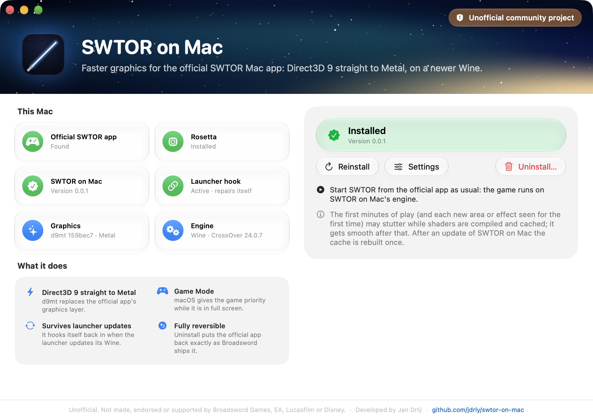
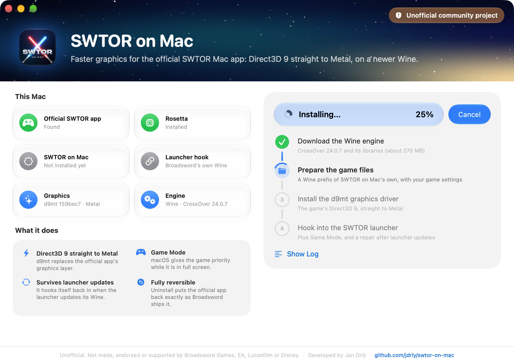
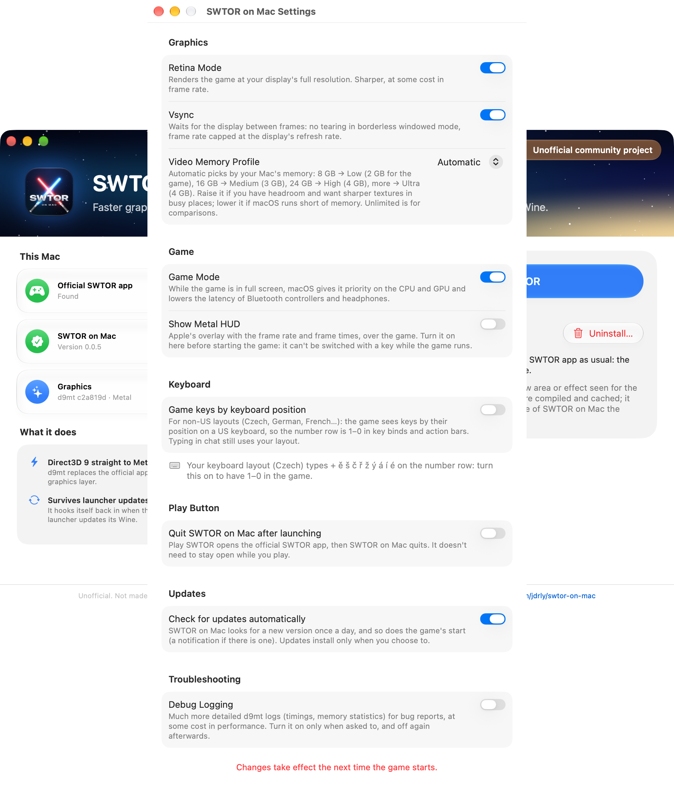
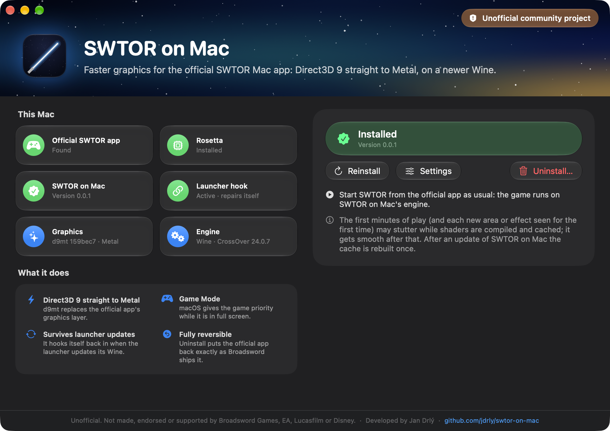
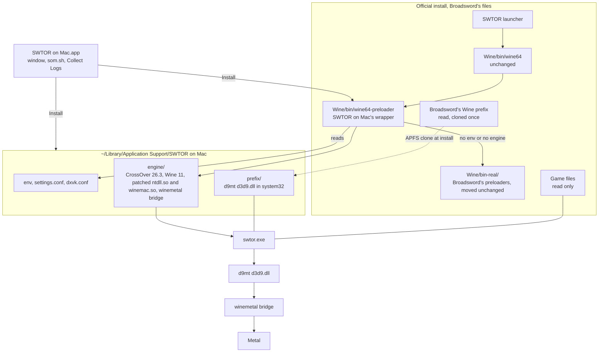
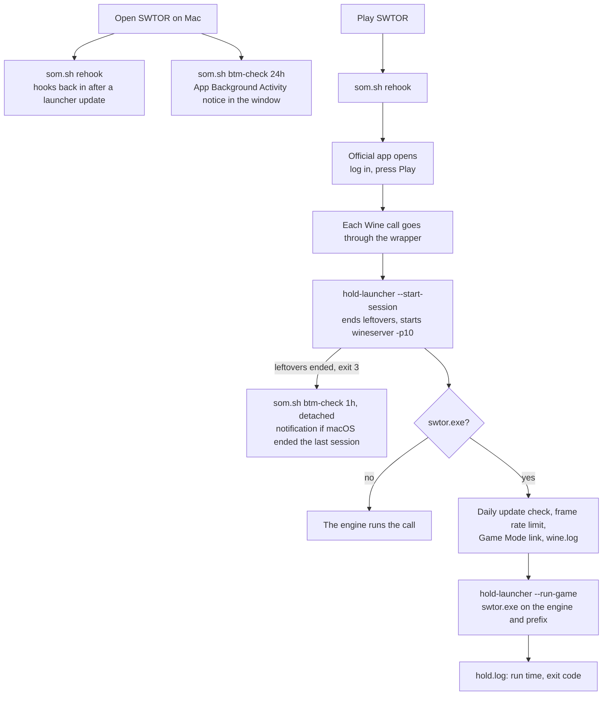
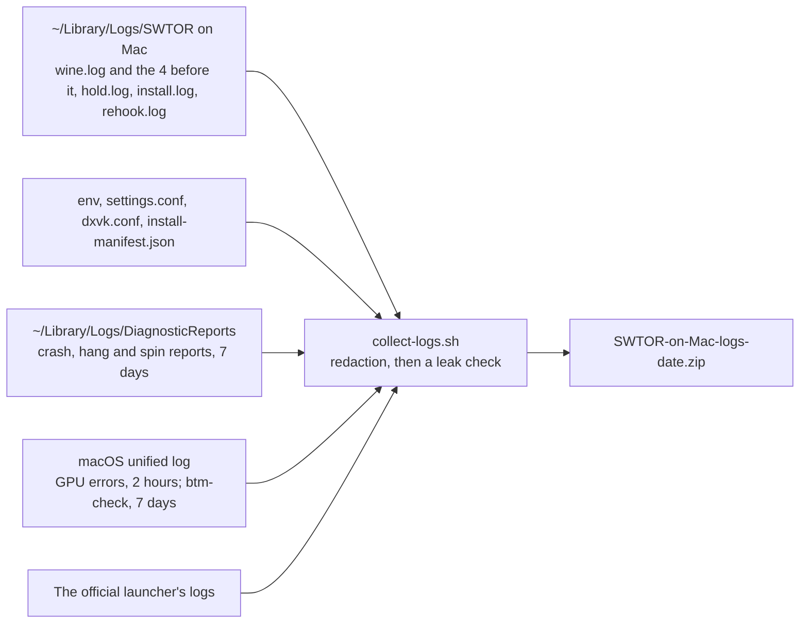

# SWTOR on Mac

SWTOR on Mac is a free macOS app for people who play Star Wars: The Old Republic with
Broadsword's official Mac app on Apple Silicon. It installs a newer Wine engine and the
[d9mt](https://github.com/jdrly/d9mt) graphics driver underneath the official app. The game's
Direct3D 9 calls then go straight to Metal, and macOS turns on Game Mode for the game.

You still log in and press Play in the official launcher, and the launcher looks and works the
same. SWTOR on Mac doesn't download or change the game or the launcher, and it doesn't touch the
game's memory or network traffic. In the official install it moves Broadsword's two Wine
preloaders aside and puts its own wrapper in their place. Uninstall puts them back the way
Broadsword ships them.

SWTOR on Mac is an unofficial community project. It is not made, endorsed or supported by
Broadsword Online Games, Electronic Arts, Lucasfilm or Disney, and you use it at your own risk.
Its developer, Jan Drlý, answers all questions about it as Pharaphobia on
[Discord](https://discord.gg/AnV3fZWz2b) and in
[GitHub issues](https://github.com/jdrly/swtor-on-mac/issues). Please don't send reports about
SWTOR on Mac to Broadsword or SWTOR customer support.

## Contents

For players:

- [What it does](#what-it-does)
- [Current version](#current-version)
- [Install](#install)
- [What to expect](#what-to-expect)
- [Getting help](#getting-help)
- [Troubleshooting](#troubleshooting)
- [Known issues](#known-issues)
- [Uninstall](#uninstall)

For developers, and anyone who wants to see exactly what it changes:

- [How it hooks into the official app](#how-it-hooks-into-the-official-app)
- [Game start](#game-start)
- [The stack](#the-stack)
- [Patches](#patches)
- [Testing](#testing)
- [Building and releasing](#building-and-releasing)
- [Pinned components](#pinned-components)
- [Documentation](#documentation)
- [Credits and licenses](#credits-and-licenses)

## What it does

The official Mac app runs the Windows game on Wine. SWTOR on Mac keeps that design and replaces
the parts underneath it:

- The game runs on CrossOver 26.3 with Wine 11, the engine that
  [SWGL on Mac](https://github.com/jdrly/swgl-on-mac) also uses. SWTOR on Mac downloads it
  from its publisher at install time and checks it against a pinned sha256.
- d9mt translates the game's Direct3D 9 calls to Metal. It compiles shaders for Metal and caches
  them on disk.
- macOS gives the game Game Mode. Retina Mode, on by default, lets the game render at the
  display's full resolution.
- The game gets its own copy of Broadsword's Wine prefix, so your game settings come along and
  Broadsword's prefix stays as it was.

The app itself is a small window with an Install button, a Play SWTOR button and a Settings
window. Settings has Retina mode, vsync, a frame rate limit for heat and battery, the video memory
d9mt reports to the game, an experimental switch for fewer GPU batches, Game Mode, the Metal HUD, game keys by keyboard position for non-US
layouts, raw mouse-look and its speed, debug logging and update checks.
[docs/settings.md](docs/settings.md) explains each one.

The app updates itself with [Sparkle](https://sparkle-project.org). It is signed with a
Developer ID and notarized by Apple. Nothing of SWTOR on Mac runs while the app is closed. There
is no login item and no launchd job.

  

[docs/screenshots](docs/screenshots) has the rest, including the notice, a failed install,
Uninstall and every Settings pane.

## Current version

The current release is [0.1.6](https://github.com/jdrly/swtor-on-mac/releases/tag/v0.1.6),
published on 30 October 2026. Every release lists its changes on the
[releases page](https://github.com/jdrly/swtor-on-mac/releases) and on
[swonmac.com](https://swonmac.com).

0.1.6's graphics driver, d9mt
[`b532e9c`](https://github.com/jdrly/d9mt/tree/b532e9c0f04b36913b8fe43bd9580c238d177e11), fixes
three problems:

- A black screen on macOS 26. d9mt tagged its compiled shaders with a Metal shader format version
  that only macOS 27 accepts, so macOS 26 rejected every shader. d9mt now tags them with the
  version each macOS expects, see [jdrly/d9mt#110](https://github.com/jdrly/d9mt/pull/110).
  Nobody has confirmed the fix in the game on a macOS 26 Mac yet.
- Magenta icons, seen on an M4 Mac. A texture the game sampled before it ever wrote to it showed
  whatever was in that memory. d9mt now reads such a texture as empty, see
  [jdrly/d9mt#105](https://github.com/jdrly/d9mt/pull/105).
- A frozen game after a GPU hang. When the GPU never finishes submitted work, d9mt writes
  `D9MT-GPU-HUNG` to `wine.log` after about 10 seconds and ends the game. Before, the game stayed
  frozen until you force quit it. See [jdrly/d9mt#53](https://github.com/jdrly/d9mt/pull/53).

Updating from 0.1.5.1 keeps your compiled shaders on macOS 27: d9mt now keys its shader cache on
the code that compiles them, and 0.1.6 compiles them to the same bytes, see
[jdrly/d9mt#122](https://github.com/jdrly/d9mt/pull/122). On macOS 26 the shaders compile once
more, because 0.1.5.1's were the ones macOS 26 rejected.

0.1.6 also carries 0.1.5.1's background activity check: when macOS doesn't allow the launcher to
run in the background, macOS ends the game's Wine once the launcher quits, and SWTOR on Mac names
the setting that fixes it. See [Troubleshooting](#troubleshooting). Collect Logs now keeps failed
game starts, the run time and exit status of the last 10 game starts and the launcher's own logs.

## Install

You need:

- A Mac with Apple Silicon and macOS 26 or later. SWTOR on Mac is developed on macOS 27.
- The official SWTOR Mac app from [swtor.com](https://www.swtor.com), installed in Applications
  and started once so it has set up the game. SWTOR on Mac refuses to install without it.
- Rosetta. macOS offers it the first time you start the official app.
- About 2 GB of free space, and an internet connection for the install. The Wine engine is a
  235 MB download.

Then:

1. Download `SWTOR-on-Mac-<version>.dmg` from
   [Releases](https://github.com/jdrly/swtor-on-mac/releases), open it and drag SWTOR on Mac
   into Applications.
2. Quit the SWTOR launcher and the game.
3. Open SWTOR on Mac and click **Review the Notice…**. Read it, tick *I understand, and I use
   SWTOR on Mac at my own risk*, click **Continue** and then **Install SWTOR on Mac**. The
   install takes a minute or two, and the window lists each step as it runs.
4. Click **Play SWTOR**, or start SWTOR from the official app as you always do. Log in and press
   Play in the launcher.

You can run the install again at any time with **Reinstall**. It keeps your game settings and
SWTOR on Mac's settings.

## What to expect

The first minutes of play may stutter, and so may a new area or effect the first time you see
it. d9mt compiles each of the game's shaders for Metal the first time the game uses it, then
caches the result. It also records which pipelines the game used and builds them again in the
background while the next session loads, so later sessions stutter less.

About 30 seconds after you press Play, the official launcher quits and plays the system alert
sound once, as it does without SWTOR on Mac. macOS keeps the launcher's icon in the Dock
as running in the background until the game ends. Don't quit it from the Dock while you play,
because macOS then ends the game with it.

When the official launcher updates its own Wine, it puts Broadsword's files back in place of
SWTOR on Mac's wrapper. The next time you open SWTOR on Mac or click Play SWTOR, it hooks itself
back in. Until then, the game runs on Broadsword's own setup.

SWTOR on Mac checks for its own updates once a day and asks before it installs one. Choose
**SWTOR on Mac > Check for Updates…** to check right away. After an update, click **Update to
&lt;version&gt;** in the window with the launcher and the game closed. That brings the installed
setup up to the app's version. [docs/updates.md](docs/updates.md) has the details.

## Getting help

1. Choose **SWTOR on Mac > Collect Logs…**. After 10 to 30 seconds it saves
   `SWTOR-on-Mac-logs-<date>.zip` to your Desktop. **Show in Finder** shows it there.
2. Create a post in #swtor-on-mac-issues on the
   [SWTOR on Mac Discord](https://discord.gg/AnV3fZWz2b) with the zip and a few lines on what
   happened and when, and tag @Pharaphobia. Or attach both to a
   [GitHub issue](https://github.com/jdrly/swtor-on-mac/issues/new/choose).

Collect Logs replaces your home folder, user name, account names, e-mail addresses and Mac's name
in what it copies. It leaves out serial numbers, device identifiers and the game's command line,
which carries account details. A last check drops any file that still contains one of them and
lists it in `left-out.txt`. [docs/logs-and-debugging.md](docs/logs-and-debugging.md) lists
everything in the zip.

Turn on Settings > Troubleshooting > Debug Logging only when asked. It makes the next game
start's logs much more detailed and costs some performance.

## Troubleshooting

The window shows the state of the official app, Rosetta, SWTOR on Mac, the launcher hook, d9mt
and the engine. Most problems show up there first.

*Official SWTOR app: Not found.* Install it from [swtor.com](https://www.swtor.com) into
Applications and start it once.

*Rosetta: Not installed.* Start the official SWTOR app once. macOS offers to install Rosetta.

*A button says the launcher, the game or Wine is running.* Quit the SWTOR launcher and the game.
SWTOR on Mac's Wine ends by itself a few seconds later.

*Leftover Wine processes.* Click **End Leftover Wine Processes**. Install, Uninstall and the
settings stored in Wine's registry end them first anyway.

*Launcher hook: Removed by a launcher update.* Click **Repair the Launcher Hook**. If the launcher
is still updating, SWTOR on Mac waits. Open it again a little later.

*Another Wine wrapper is installed.* Another tool or a manual setup already replaced Broadsword's
Wine preloaders. SWTOR on Mac leaves it alone unless you confirm, and then keeps a copy in
`~/Library/Application Support/SWTOR on Mac/backup/`.

*The launcher closes after Play and the game never shows up.* macOS doesn't allow the launcher
to run in the background. Open System Settings > Login Items, and under *App Background
Activity* turn on Star Wars - The Old Republic, which may be listed as Broadsword. Then press Play
again. SWTOR on Mac's window says when this happened in the last 24 hours, the next Play posts a
notification, and Collect Logs lists the last 7 days.

*An install failed.* The window says why, and the install rolled back. The full log is
`~/Library/Logs/SWTOR on Mac/install.log`. Click **Try Again**, or send the Collect Logs zip.

*The game doesn't start, crashes or looks wrong.* Collect Logs and report it. To compare with the
official setup, uninstall SWTOR on Mac. The official app then runs exactly as Broadsword ships
it. If the problem stays after Uninstall, it isn't caused by SWTOR on Mac.

## Known issues

- A rare GPU error can freeze the whole screen, not only the game. macOS may restart the
  graphical session and return you to the login screen. If it happens, open SWTOR on Mac soon
  afterwards and send the Collect Logs zip, which holds the GPU errors of the last 2 hours.
- On 8 GB and 16 GB Macs the game gets 2 or 3 GB of video memory instead of the official app's
  4 GB, so busy places can show blurry or missing textures. Raise *Video Memory Profile* in
  Settings > Graphics if macOS has memory to spare.
- Raw mouse-look is on by default. If mouse-look feels wrong, turn it off in Settings > Mouse to
  compare, and report it with Debug Logging on. Its speed matches your pointer speed from about a
  second into the first mouse-look.
- With *Game keys by keyboard position* on, keys follow US positions, so on Czech and German
  layouts the game swaps the names of Z and Y.
- Retina Mode and the keyboard and mouse settings can only change while the launcher and the game
  are closed, because they live in Wine's registry.
- If you open the Cartel Market right after closing it, the game sometimes ignores the press. It
  does the same on Windows. Press again.
- SWTOR on Mac supports only the official Mac app from swtor.com. It doesn't work with the Windows
  or Steam version in CrossOver or another Wine setup.

## Uninstall

Quit the launcher and the game, open SWTOR on Mac and click **Uninstall…**. It copies your game
settings, UI layouts and key bindings back to Broadsword's prefix first and keeps the previous
ones beside them as `settings-backup-<time>`. Then it puts Broadsword's Wine files back and
deletes SWTOR on Mac's engine, prefix, settings and downloads. Your characters live on the server
and don't change. Logs stay in `~/Library/Logs/SWTOR on Mac`. Then move the app to the Bin.

If the app is gone or Uninstall can't run, you can remove SWTOR on Mac by hand with the Terminal
commands in [docs/how-it-works.md](docs/how-it-works.md#removing-it-by-hand). Unlike Uninstall,
they don't copy your game settings back, and they delete SWTOR on Mac's prefix, which holds your
current UI layouts and key bindings. Copy the settings folder first, as that page describes.

## How it hooks into the official app

The official launcher starts every Wine process through `bin/wine64`, which loads
`bin/wine64-preloader`. Install moves Broadsword's two preloaders into `bin-real/` and puts
SWTOR on Mac's wrapper script, [`src/wine-wrapper.sh`](src/wine-wrapper.sh), in their place. The
wrapper runs each command on SWTOR on Mac's engine and prefix. If those are missing, it hands the
command to Broadsword's own preloader.
[ADR 0003](docs/adr/0003-hook-through-the-preloaders.md) records why the hook sits there.

This is everything Install changes in Broadsword's install, under `~/Library/Application
Support/com.broadsword.swtor/Star Wars - The Old Republic/swtor-precompiled/Libraries/Wine`:

| | Before | After |
|---|---|---|
| `bin/wine64-preloader`, `bin/wine-preloader` | Broadsword's Wine preloaders | SWTOR on Mac's wrapper script |
| `bin-real/` | not there | Broadsword's preloaders, moved unchanged, and two small helpers, `hold-launcher` and `setsid-exec` |

SWTOR on Mac only reads the game files, the launcher app and Broadsword's Wine prefix. It
clones the prefix once with APFS. Everything else lives in its own folders under
`~/Library/Application Support/SWTOR on Mac`, `~/Library/Caches/SWTOR on Mac` and
`~/Library/Logs/SWTOR on Mac`. The only processes it ever ends are leftover Wine processes of its
own engine.

Install is all-or-nothing. It refuses while the launcher or the game runs, prepares everything in
SWTOR on Mac's folders first, changes Broadsword's folder last and rolls back if any step fails.
It records each change in `install-manifest.json`, and Uninstall uses that record to restore the
folder. The sandbox test checks that Uninstall restores Broadsword's folder byte for byte.

The wrapper starts the engine's wineserver in a session of its own, so the game keeps running
after the launcher quits. For the game, `swtor.exe`, it also writes the game's output to
`wine.log` and runs the game through a small app bundle with `LSSupportsGameMode`, so macOS turns
Game Mode on. When the game ends, nothing of SWTOR on Mac
keeps running. [ADR 0005](docs/adr/0005-no-background-helper.md) records that rule.
[docs/how-it-works.md](docs/how-it-works.md) covers every file and step.

## Game start

Collect Logs, `src/collect-logs.sh`, gathers these files along with system information such as
the macOS version, chip and memory. It redacts every file before it goes into the zip:

## The stack

| Part | What it is | Where |
|---|---|---|
| The window | A SwiftUI app that runs the installer and shows its progress | [`src/native`](src/native) |
| The installer | `som.sh`, a `/bin/bash` 3.2 script: status, install, uninstall, settings, the hook check | [`src/som.sh`](src/som.sh) |
| The wrapper | The script in the preloaders' place | [`src/wine-wrapper.sh`](src/wine-wrapper.sh) |
| Helpers | `hold-launcher` starts the Wine session and runs the game; `setsid-exec` starts a program in a new session | [`src/helpers`](src/helpers) |
| Wine engine | CrossOver 26.3 with Wine 11, built by [athei/wine-build](https://github.com/athei/wine-build), downloaded at install time | [ADR 0001](docs/adr/0001-one-engine-crossover-26-3.md), [ADR 0002](docs/adr/0002-engine-downloaded-not-redistributed.md) |
| Graphics | d9mt's `d3d9.dll` and its `winemetal` bridge, Direct3D 9 to Metal | [`prebuilt/d9mt`](prebuilt/d9mt) |
| Wine patches | SWTOR on Mac's builds of Wine's Mac driver and `ntdll.so` | [`patches`](patches), [`prebuilt`](prebuilt) |
| Updates | Sparkle 2.10.0, with an EdDSA-signed feed | [`build.sh`](build.sh) |
| Collect Logs | The script behind the menu item | [`src/collect-logs.sh`](src/collect-logs.sh) |

The engine's own `ntdll.so`, `winemac.so` and Wine's `d3d9.dll` stay in place next to SWTOR on
Mac's builds as `.stock` and `.wine` copies.

## Patches

SWTOR on Mac builds two Wine components from the engine's own sources, athei/wine at
[`d23b397`](https://github.com/athei/wine/tree/d23b39774528237cafe49f9a073286f854b779c0), with
these patches:

- [`patches/ntdll-msync-alert-fd.patch`](patches/ntdll-msync-alert-fd.patch). CodeWeavers' msync
  port stores a thread's msync alert index in the field where Wine 11 keeps the thread's alert
  file descriptor. When a thread that did an alertable wait exits, Wine closes that field as a
  descriptor, which closes an unrelated file, pipe or kqueue. With msync on, the patch leaves it
  alone, the same guard as athei/wine `12927acab0` on another branch. This build is always
  installed.
- [`patches/winemac-physical-keys.patch`](patches/winemac-physical-keys.patch) for *Game keys by
  keyboard position*. The game sees each key by its position on a US keyboard, while chat still
  types in your layout.
- [`patches/winemac-swgl-relative-mouse.patch`](patches/winemac-swgl-relative-mouse.patch) and
  [`patches/winemac-swgl-input-thread.patch`](patches/winemac-swgl-input-thread.patch), unchanged
  copies of SWGL on Mac's mouse-look patches. While the game hides the pointer, the macOS pointer
  stays put and the game gets relative motion from GameController's `GCMouse`. An input thread
  sends those moves to the Wine server as they arrive, about 1000 a second for a typical mouse.
  Stock Wine moves the real pointer for every `SetCursorPos` the game calls and delivers moves
  about one display refresh late.
- [`patches/winemac-swtor-mouse.patch`](patches/winemac-swtor-mouse.patch), SWTOR's changes to
  those two. It matches the camera speed to the pointer speed set in System Settings and turns
  off the parts SWG needs and SWTOR doesn't.

SWTOR on Mac installs the patched Mac driver only while *Game keys by keyboard position* or *Raw
mouse-look* is on. The build scripts, [`scripts/build-ntdll.sh`](scripts/build-ntdll.sh) and
[`scripts/build-winemac.sh`](scripts/build-winemac.sh), also build an unpatched copy. They check
that it matches the engine's own file and that the patches change only the functions they target. Upstream Wine has no fix for the `SetCursorPos` mouse-look problem yet, so the mouse
patches stay.

d9mt carries its own changes. Its [repository](https://github.com/jdrly/d9mt) has them, and
[docs/building.md](docs/building.md#d9mt-pin) lists the ones in the pinned commit.

## Testing

Every pull request and every push to `main` runs
[`.github/workflows/checks.yml`](.github/workflows/checks.yml). It lints the scripts with
shellcheck and the workflows with actionlint, checks the scripts' syntax under macOS's
`/bin/bash` 3.2, builds the app on macOS 27 with Xcode 27, checks that every binary in it runs on
macOS 26, runs the installer in an empty sandbox and runs the fixture checks on the packaged
app.

The installer's end-to-end test needs the official app, so it runs on a developer's Mac, never
against the real install:

- [`scripts/test-sandbox.sh`](scripts/test-sandbox.sh) builds a sandbox from an APFS clone of
  Broadsword's Wine folder and a stand-in for the official app. It runs Install, every setting,
  Reinstall, a simulated launcher update, leftover Wine processes, a failed install, Collect Logs,
  updates from and back to older releases, and Uninstall. Uninstall must restore Broadsword's
  folder byte for byte and leave no Wine process behind.
- [`scripts/test-btm.sh`](scripts/test-btm.sh) tests the background activity check on planted
  log lines.
- [`scripts/test-fixtures.sh`](scripts/test-fixtures.sh) runs the checks that need neither the
  official app nor Wine. CI runs it too.
- [`scripts/test-update.sh`](scripts/test-update.sh) tests app updates with two signed builds and
  a local feed.

`SWTOR_ON_MAC_ROOT=/abs/dir` moves every path the installer uses under one folder, and
`SWTOR_ON_MAC_DRY_RUN=1` prints the changes without making them. The app passes both on.
[docs/testing.md](docs/testing.md) describes each check.

## Building and releasing

`scripts/build-d9mt.sh`, `scripts/build-winemac.sh` and `scripts/build-ntdll.sh` build the
binaries in `prebuilt/` reproducibly from pinned sources. `build.sh` assembles `dist/SWTOR on
Mac.app` from a fresh clone and needs Xcode 27. A `v*` tag starts the Release workflow,
which builds, signs and notarizes the app. The maintainer finishes the Sparkle feed on the Mac
that holds its EdDSA key, which never leaves that Mac. [docs/building.md](docs/building.md) has the steps, and
[ADR 0004](docs/adr/0004-releases-in-two-halves.md) the reasons.

## Pinned components

| Component | Source | sha256 |
|---|---|---|
| Wine engine `cx-26.3.0-8`, CrossOver 26.3 with Wine 11.0, x86_64 WoW64 | [athei/wine-build cx-26.3.0-8](https://github.com/athei/wine-build/releases/download/cx-26.3.0-8/wine-cx-26.3.0-8-macos-x86_64.tar.xz) | `1976c3310a1f8be2f8e9a46fcb524f77b4316df3d281d94af2c8542bef60456d` |
| Sparkle 2.10.0, bundled | [sparkle-project/Sparkle](https://github.com/sparkle-project/Sparkle/releases/tag/2.10.0) | `c2bf58aa8387266ac179357b1415d6f2635f044da8be41042af32425dae6da0c` |
| d9mt `73511be`, bundled in `prebuilt/d9mt` | [jdrly/d9mt](https://github.com/jdrly/d9mt/tree/73511bed36cf9264d8421f880e7d1bdde32952d9) | see `prebuilt/d9mt` |
| Wine sources for the Mac driver and `ntdll.so`, athei/wine `d23b397` | [athei/wine](https://github.com/athei/wine/tree/d23b39774528237cafe49f9a073286f854b779c0), codeload tar.gz | `7002111d61bbf28e88cc2504080747d27d074907a7e278f6c78cf6cefe09746e` |
| llvm-mingw 20261006, only to configure that build | [mstorsjo/llvm-mingw](https://github.com/mstorsjo/llvm-mingw/releases/tag/20261006) | `a7a19b11048e89372637d26279cdb7c430ed3cf8c1e224310421312bf986ebf6` |

Release 0.1.6 was built from `main` with d9mt `b532e9c`. Release 0.1.5.1 was built from the
`release/0.1.5` branch with the d9mt build it shipped.

## Documentation

- [docs/settings.md](docs/settings.md): the window, the Play SWTOR button and every setting.
- [docs/updates.md](docs/updates.md): app updates, the engine download and development builds.
- [docs/logs-and-debugging.md](docs/logs-and-debugging.md): what Collect Logs collects, Debug
  Logging, session reports and d9mt's live debug flags.
- [docs/how-it-works.md](docs/how-it-works.md): every file SWTOR on Mac changes or creates, the
  wrapper, launcher updates and removal by hand.
- [docs/testing.md](docs/testing.md): the sandbox test and the fixture checks.
- [docs/building.md](docs/building.md): building and releasing.
- [docs/adr](docs/adr/index.md): the design decisions.
- [CONTEXT.md](CONTEXT.md): the terms the project uses.
- [CONTRIBUTING.md](CONTRIBUTING.md) and [SECURITY.md](SECURITY.md).

## Credits and licenses

- Star Wars: The Old Republic, its launcher and its game files belong to their owners,
  Broadsword Online Games, Electronic Arts, Lucasfilm and Disney. SWTOR on Mac ships none of
  them.
- [d9mt](https://github.com/jdrly/d9mt) by Jan Drlý is a fork of neo773's
  [d9mt-v2](https://github.com/neo773/d9mt-v2) with code from DXVK and DXMT. It is under the
  zlib license, and its winemetal bridge under LGPL-2.1-or-later, with its source in `bridge/` of
  the pinned commit. Its licenses and notices ship in the app under `Resources/Licenses/d9mt`.
- [Wine](https://www.winehq.org), LGPL-2.1-or-later, comes from CodeWeavers'
  [CrossOver 26.3 sources](https://www.codeweavers.com/crossover/source) with athei's patches in
  [athei/wine](https://github.com/athei/wine), built and bundled by
  [athei/wine-build](https://github.com/athei/wine-build). SWTOR on Mac downloads the engine
  from that release at install time and doesn't redistribute it.
- Wine's Mac driver and `ntdll.so`, LGPL-2.1-or-later, are built from the engine's sources with
  the [patches](#patches) above. They ship in the app with Wine's license and the patches under
  `Resources/Licenses/winemac` and `Resources/Licenses/ntdll`.
- [Sparkle](https://sparkle-project.org) handles app updates. It is under the MIT license, with
  bsdiff and other notices in the app under `Resources/Licenses/sparkle`.
- The window uses the typefaces of [swonmac.com](https://swonmac.com),
  [Unbounded](https://github.com/googlefonts/unbounded) and
  [JetBrains Mono](https://github.com/JetBrains/JetBrainsMono), both under the SIL Open Font
  License 1.1, unmodified in `src/fonts`.
- SWTOR on Mac follows the example of [SWGL on Mac](https://github.com/jdrly/swgl-on-mac).

[THIRD_PARTY_NOTICES.md](THIRD_PARTY_NOTICES.md) lists what the app bundles and what it downloads
at install time, with their licenses. The app has the same file under `Resources/Licenses`.

STAR WARS is a registered trademark of Lucasfilm Ltd. Star Wars: The Old Republic and SWTOR are
trademarks of their respective owners. Mac is a trademark of Apple Inc.

## License

The code in this repository is under the [zlib license](LICENSE). The patches in `patches/`
change Wine and so stay under Wine's LGPL-2.1-or-later. The files in `prebuilt/` and everything
the build or the installer downloads keep their own licenses. d9mt's are in `prebuilt/d9mt`, the
Mac driver's in `prebuilt/winemac` and `ntdll.so`'s in `prebuilt/ntdll`.
